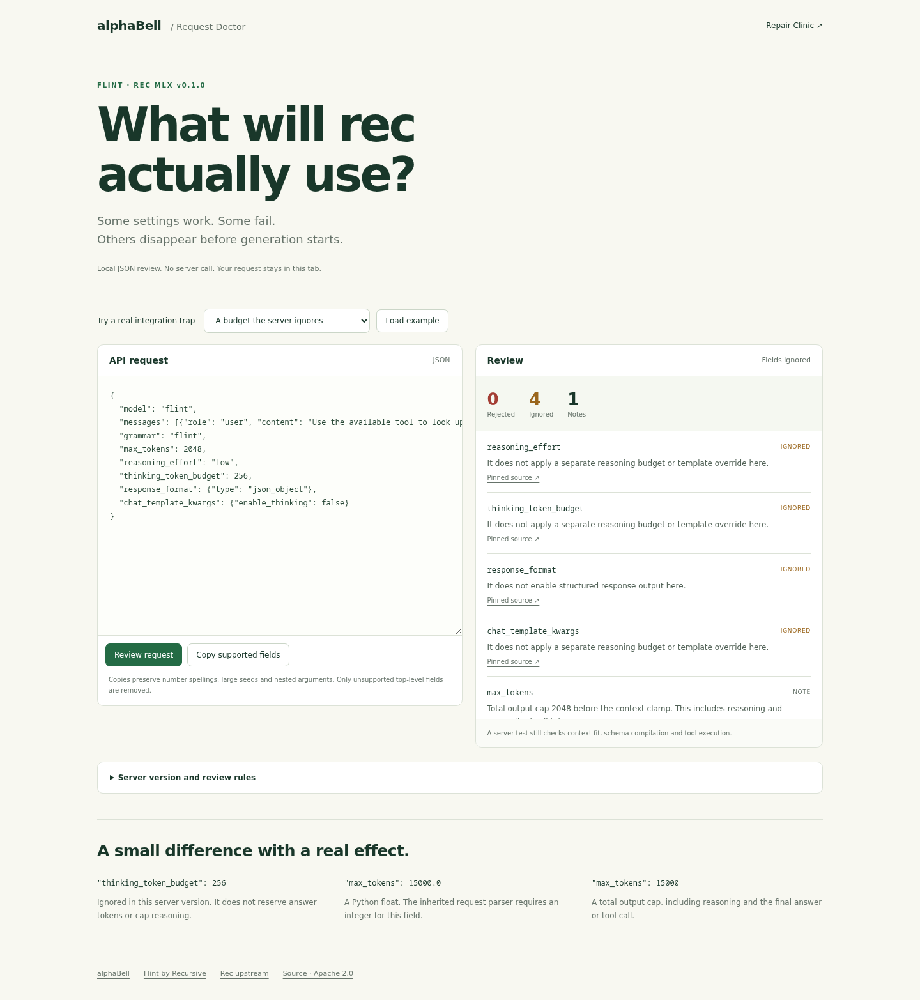

# Flint Request Doctor by alphaBell

Paste an OpenAI-compatible request body and see which settings the public Rec MLX server accepts, rejects or silently ignores. The review runs locally in your browser. It sends no inference request and stores no request history.

**[Try Flint Request Doctor](https://huggingface.co/spaces/alphabell/Flint-Request-Doctor)**

Try the built-in examples for ignored reasoning controls, `15000.0` versus `15000`, grammar/stop conflicts, competing token caps and unsupported forced tool calls. Every diagnostic links to pinned source.

The target is **Rec MLX v0.1.0**, using public Rec revision `8af99abaf50b33903147d89eed91d1bb3ac642dd` from October 22, 2026, and its pinned `mlx-lm==0.31.3` dependency. Other backends and later versions can behave differently.

## What the review checks

- Unsupported top-level fields are **ignored**, including `response_format`, `reasoning_effort`, `thinking_token_budget` and `chat_template_kwargs`.
- `max_tokens` and non-null `max_completion_tokens` bound total output, including reasoning. The latter takes precedence. Neither provides a separate reasoning allowance.
- The Python parser requires integer token-limit, top-k and seed fields. Decimal and exponent spellings remain distinguishable even when JavaScript represents their value as an integer.
- Flint grammar conflicts with nonempty custom stops. An empty stop array is accepted.
- Forced `tool_choice`, `parallel_tool_calls:false`, stored completions and selected non-neutral sampling settings are unsupported in this version.
- Message roles, option types, sampling ranges and selected stream combinations receive local compatibility checks.

The standard server default uses Flint grammar. A control in the review-rules drawer lets you account for a server configured with grammar disabled. Explicit request grammar overrides that default.

“Copy supported fields” removes unknown top-level fields while retaining the original value text, including large seeds and nested numeric tool arguments. It keeps rejected settings for you to review. It does not claim to produce a complete valid request automatically.

Context fit, schema compilation, authentication, queue state, message content normalization and actual tool execution require the running server. The seed's final upper bound depends on its context-clamped output limit. The local review reports a note for that boundary rather than inferring a context length.

## Validation and source

Run `node --test` for the JavaScript regression suite. Run `python reference_check.py` to compare its supported/rejected and ignored-field decisions with validation functions extracted from the pinned upstream source. That script downloads the two pinned source revisions and compiles only the inherited request validator, Rec request validator and Sampling class. It does not import MLX, load weights, run an HTTP server or generate text. The test uses a synthetic remaining context of 8,192 tokens; it does not measure model quality or full serving acceptance.

For the UI checks, install `requirements-dev.txt`, install Playwright Chromium, then run `python verify.py`. The script starts its own local static server and closes its browser afterward.

Primary references: [Rec request handling](https://github.com/recursive-oss/rec/blob/8af99abaf50b33903147d89eed91d1bb3ac642dd/engine/src/rec_mlx/server.py), [inherited request types](https://github.com/ml-explore/mlx-lm/blob/ed1fca4cef15a824c5f1702c80f70b4cffc8e4dd/mlx_lm/server.py#L1160-L1250), [Rec sampling rules](https://github.com/recursive-oss/rec/blob/8af99abaf50b33903147d89eed91d1bb3ac642dd/engine/src/rec_mlx/engine.py#L23-L45).

[Source on GitHub](https://github.com/alphabell-research/flint-request-doctor) · [Flint by Recursive](https://huggingface.co/RecursiveSI/flint) · [Rec upstream](https://github.com/recursive-oss/rec) · [Flint Repair Clinic](https://huggingface.co/spaces/alphabell/Flint-Repair-Clinic) · [alphaBell](https://huggingface.co/alphabell)
